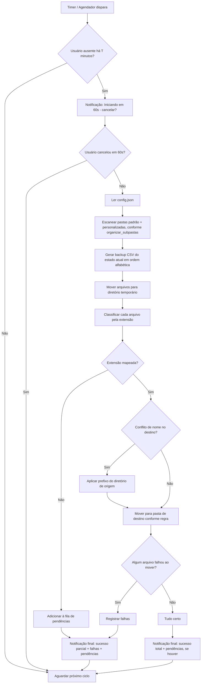

# Especificação Técnica — Organizador de Arquivos para Windows

**Versão atual: 2.5**

## Notas de Atualização

### Nota de Atualização - 2.5 (correção da borda DWM + rodada de polimento)
Duas partes: fix pontual + auditoria completa do projeto. Ver `docs/RELATORIO_POLIMENTO.md` para o relatório detalhado tela por tela e arquivo por arquivo.

- **Borda branca residual corrigida**: `TemaJanelaEscura.cs` agora também aplica `DWMWA_BORDER_COLOR` (34), `DWMWA_CAPTION_COLOR` (35) e `DWMWA_TEXT_COLOR` (36), além do `DWMWA_USE_IMMERSIVE_DARK_MODE` já existente — a "borda de destaque" do Windows 11 é controlada separadamente da barra de título, por isso continuava branca mesmo com o modo escuro já funcionando.
- **Achado sério corrigido**: `PendenciaService`, `RecallService`, `SugestaoService` e `PacoteBackupService` não tratavam JSON corrompido — como os quatro carregam no construtor da `MainWindow`, um arquivo corrompido em qualquer um deles derrubava o app inteiro antes de abrir. Novo `ArquivoJsonUtils.CarregarListaResiliente<T>` usado pelos quatro: renomeia o arquivo problemático (`.corrompido-{timestamp}`) e segue com lista vazia em vez de propagar a exceção.
- **Duplicação removida**: `GoogleDriveService.EnviarArquivoAsync`/`EnviarArquivoComLinkAsync` tinham ~30 linhas idênticas, consolidadas num método privado compartilhado sem mudar nenhuma assinatura pública.
- **Consistência visual padronizada**: margem de container raiz unificada em `16` (estava uma mistura de 8/12/16/20 sem critério) e padding de botões unificado em `8,4` (estava uma mistura de 8,4/10,4/10,5/10,6/12,4) em toda a `MainWindow`, `SubpastasWindow` e `DetalhesPacoteWindow`. Estado vazio de Deletar reestruturado para seguir o padrão "título + linha de contexto" já usado em Sugestões/Cubos/Histórico.
- **Precisão de relatório**: `BackupNuvemService` contava um arquivo já inexistente como "deletado com sucesso"; agora esse caso não conta nem como sucesso nem como falha.
- **Documentação**: seção "O que já está implementado" do `README.md` estava travada na estrutura de 5 telas anterior à Camada 1 — atualizada para as 8 abas atuais.
- **Validado como já correto** (sem mudanças): os três fluxos de comportamento pedidos para checagem (backup antes de deletar, confirmação antes de exclusão irreversível, não deletar local antes de confirmar upload) — todos implementados exatamente como especificado.
- **Itens em aberto documentados no relatório**: cor fixa dos ícones da sidebar, heurística de correlação Histórico↔Recall por horário, e a decisão consciente de não consolidar os dois fluxos de exclusão (Deletar/Sugestões) por segurança dado o volume desta rodada.

### Nota de Atualização - 2.4 (refinamento visual — 5 frentes)
Rodada grande de polimento, sem mudar a lógica de negócio existente — reestruturação de navegação + visual.

- **Barra de título escura**: novo `TemaJanelaEscura.cs`, P/Invoke em `DwmSetWindowAttribute` com `DWMWA_USE_IMMERSIVE_DARK_MODE` (tenta o valor 20 e cai para 19 em builds mais antigos do Windows 10), aplicado nas 3 janelas do app. Mantém os controles nativos de minimizar/maximizar/fechar — sem chrome customizado.
- **Estados vazios restantes**: Login ganhou um ícone de nuvem (mesma paleta cinza das outras ilustrações) e um chip visual ("● email@conta.com") substituindo o texto solto "Conectado" quando há sucesso. Deletar ganhou uma zona de arraste **funcional** (não só decorativa) — `AllowDrop`/`Drop`/`DragEnter`/`DragLeave` de verdade, com borda tracejada (`Rectangle` com `StrokeDashArray`, já que `Border` não suporta traço tracejado nativamente) que destaca em vermelho durante o arraste.
- **Sidebar recolhível com ícones**: cada item do menu lateral ganhou um ícone desenhado à mão (pasta, borracha, lixeira, lâmpada, relógio, engrenagem, nuvem, e o cubo colorido da marca para "Cubos" — os únicos 6 monocromáticos usam `TextPrimaryBrush` fixo por segurança, não uma cor dinamicamente vinculada ao estado do TabItem, para evitar depender de um binding via `RelativeSource`+`ContentPresenter` não testável neste ambiente). Botão de recolher embutido no template do `TabControl`, localizado via `FrameworkTemplate.FindName` após `Loaded` (mecanismo padrão do WPF para alcançar partes nomeadas dentro de um `ControlTemplate` a partir do code-behind). Tooltip com o nome da aba sempre presente (útil tanto recolhido quanto expandido).
- **Reorganização de navegação**: "Configurações" virou item próprio da sidebar (fora dos módulos) — absorveu tudo que antes era a sub-aba "Configurações gerais" de Organizar (agendamento, diretórios, iniciar com Windows, executar agora). Organizar ficou só com Regras de extensão e Pendências. **Recall foi absorvido pela aba Histórico** — mesma tela agora, com um novo botão "Ver itens desta execução" que filtra o Recall pelos itens cujo `MovidoEm` fica a até 5 minutos do horário do backup CSV selecionado (heurística por proximidade de horário, já que não existe um vínculo gravado diretamente entre os dois — documentado como tal no código). O guard de navegação que bloqueava sair do Recall com marcações não salvas foi simplificado (protege a saída da aba Histórico diretamente, em vez da lógica aninhada de duas camadas que existia quando o Recall vivia dentro de Organizar).
- **Hover na sidebar**: já existia de uma versão anterior (`MultiTrigger` com `SidebarHoverBrush`) — conferido que sobreviveu à reescrita da estrutura de navegação, nenhuma mudança necessária.
- **Aliases novos**: `Button` e `ColumnDefinition` adicionados à lista de aliases WPF/WinForms deste arquivo (mesma categoria de risco de sempre — `UseWindowsForms=true` injeta um using implícito para `System.Windows.Forms`, que também tem esses dois nomes).

### Nota de Atualização - 2.3 (estados vazios + ícone do app)
- **Estados vazios ilustrados** em 3 telas, substituindo texto cinza genérico por ilustração + microtexto (título curto, uma linha de contexto, botão quando fazia sentido):
  - **Sugestões**: pilha de 3 cubos cinza (SVG fornecido reaproveitado ponto a ponto, convertido em `Polygon`/`Canvas` nativos do WPF — sem precisar de biblioteca de renderização de SVG). "Tudo limpo por aqui" + botão "Analisar agora" (mesmo handler do botão do topo, ambos sincronizados durante a análise).
  - **Cubos**: um cubo cinza único a 40% de opacidade, "flutuando" — reaproveita a mesma geometria de 3 polígonos do cubo colorido real, só que sem cor. "Nenhum cubo ainda", sem botão (não faz sentido forçar um envio a partir daqui).
  - **Histórico**: gaveteiro simples com uma gaveta entreaberta (silhueta em `Rectangle`s, tons entre `#3f4147` e `#9a9da3`, sem SVG fornecido — desenhado seguindo a mesma paleta). "Nada guardado ainda".
  - Implementado sem MVVM/converters, no mesmo estilo code-behind do resto do app: cada `Carregar*()` alterna a `Visibility` entre a grid/lista normal e o painel de estado vazio, dependendo da contagem de itens.
- **Ícone do app**: gerado `app.ico` (multi-resolução: 16/32/48/64/128/256) a partir do SVG dos "3 cubos coloridos sobre fundo escuro" fornecido — sem ferramenta de conversão SVG→ICO disponível no ambiente de desenvolvimento (nem `rsvg-convert`, nem `inkscape`), desenhado manualmente com Pillow reproduzindo as mesmas coordenadas/cores do SVG em alta resolução (4x) e reduzido com antialiasing. Ativado via `ApplicationIcon` no `.csproj`. O ícone da bandeja do sistema (`TrayIconManager`) passou a extrair esse mesmo ícone do executável em runtime (`Icon.ExtractAssociatedIcon`), com fallback pro ícone padrão do Windows se a extração falhar (ex.: rodando via `dotnet run`, onde o executável real é o `dotnet.exe`).

### Nota de Atualização - 2.2 (Camada 3 — backup em nuvem + Camada 4 — Cubos)
Implementadas juntas por estarem diretamente conectadas: cada pacote enviado na Camada 3 vira um item visual na Camada 4.

**Camada 3 — fluxo de backup em nuvem:**
- **"Sem token bruto"**: substituído o `FileDataStore` padrão do Google (grava o token OAuth em texto puro) por `DpapiDataStore`, uma implementação própria de `IDataStore` que criptografa cada valor com DPAPI (`ProtectedData`, ligado à conta do Windows do usuário) antes de gravar em disco. Exigiu o pacote `System.Security.Cryptography.ProtectedData` (não incluído por padrão nem em TFMs `-windows`).
- **Fluxo "compactar → enviar → só então apagar local"**: novo `BackupNuvemService.EnviarEDeletarAsync` — compacta os arquivos num `.zip` nomeado com data/hora (`CubeBin-Backup-AAAA-MM-DD_HHmmss.zip`), envia ao Drive, e só apaga os arquivos locais depois de confirmar que o upload terminou. Qualquer falha antes dessa confirmação (compactação ou upload) não apaga nada local — mesma filosofia de segurança já usada em `ArquivoUtils`/Recall/Deletar.
- **Falha no envio**: usuário é avisado com a mensagem de erro específica; "tentar novamente" é simplesmente clicar no mesmo botão de novo (o estado não fica travado).
- Integrado como um botão adicional ("Enviar à nuvem e excluir" / "Enviar aprovadas à nuvem") tanto no módulo Deletar quanto em Sugestões, ao lado dos botões de exclusão direta já existentes — reaproveitando um fluxo compartilhado (`EnviarArquivosParaNuvemEExcluirAsync`) para não duplicar confirmação/erro/relatório em dois lugares.
- Relatório final (via `MessageBox` + notificação) resume: pacote enviado, quantos arquivos foram removidos localmente, e eventuais falhas ao remover localmente (o arquivo já está seguro na nuvem nesse caso, só não saiu do disco).

**Camada 4 — visualização dos "Cubos":**
- Nova aba "Cubos": cada `PacoteBackup` (persistido em `pacotes.json` via `PacoteBackupService`) vira um cubo isométrico desenhado com `Polygon` (3 faces, cores do tema preto/vermelho) — **não há um ícone/logo oficial do CubeBin ainda**, então esta é uma representação genérica nas cores do app, não uma reprodução de um logo definido.
- Opacidade proporcional ao tamanho do pacote em relação ao maior já enviado (pacotes grandes mais sólidos, pequenos mais translúcidos), calculada em `CuboExibicao`.
- Hover mostra contagem por categoria (Fotos, Músicas, Vídeos, Documentos, Compactados, Outros — classificadas por `CategoriaArquivo`) via `ToolTip`.
- Clique abre `DetalhesPacoteWindow`: lista de arquivos do pacote, data do envio, link "Abrir no Google Drive" (via `webViewLink`, obtido por um novo método `GoogleDriveService.EnviarArquivoComLinkAsync` — separado do `EnviarArquivoAsync` original para não alterar o pipeline principal de organização), e "Restaurar" (baixa o `.zip` de volta e descompacta na pasta escolhida).
- Novos campos de config (`CaminhoDriveBackups`, `ArquivoPacotesBackup`) — o segundo, por ser um caminho computado em runtime, já entra com migração automática desde o commit inicial desta feature (lição do bug do `ArquivoRecall`, 1.14, aplicada de novo).

### Nota de Atualização - 2.1 (Camada 2 — agente de sugestões)
Novo módulo opcional, **desativado por padrão**: um agente que monitora o disco em segundo plano e sugere arquivos que podem ser limpos, sem apagar nada automaticamente.

- **"IA" é heurística local, sem custo/dependência externa** — exatamente como pedido. Três critérios: (1) arquivos duplicados por hash (SHA-256, agrupados por tamanho primeiro para não hashear tudo à toa), (2) temporários/cache (`.tmp`, `.cache`, `.bak`, `.old`, `.log`) sem "toque" há N dias, (3) arquivos grandes (acima de um tamanho mínimo configurável) parados há N dias.
- **Nota técnica sobre "não usado há N dias"**: o Windows costuma desabilitar a atualização de `LastAccessTime` por performance desde o Vista — usamos o mais recente entre `LastAccessTime` e `LastWriteTime` como aproximação melhor-esforço, documentado no código.
- **Escopo do scan**: as mesmas pastas monitoradas já configuradas em Organizar/Limpar — nunca o disco inteiro (por segurança e desempenho; hashear um disco inteiro seria proibitivamente lento).
- **Fluxo de revisão** (nova aba "Sugestões"): grid com arquivo, tipo, motivo, tamanho estimado e status. Aprovação/ignorar item a item ou em lote (seleção múltipla + botões). Exclusão real só num passo separado ("Excluir aprovadas"), com a mesma confirmação explícita e backup CSV prévio do módulo Deletar — nunca automático.
- **Agendamento**: `AgenteScheduler` (App) roda na mesma checagem de ausência (`IdleDetectionService`/`TempoAusenciaMinutos`) já usada pelo resto do app, com frequência própria e configurável (`AgenteExecucoesPorDia`/`AgenteHorarioInicio`, mesmo mecanismo de N-vezes-por-dia do `BackgroundScheduler`).
- **Novos arquivos**: `TipoSugestao`, `SugestaoLimpeza` (Models); `SugestaoService` (persistência em `sugestoes.json`, com migração automática do caminho para configs antigos — lição aplicada desde o início desta vez), `AgenteSugestaoService` (as heurísticas), `FormatarBytes` (utilitário compartilhado); `AgenteScheduler` (App).

### Nota de Atualização - 2.0 (releitura "Camada 1")
Reorganização estrutural grande, a pedido de uma releitura do projeto com foco em 3 módulos. Toda a lógica de negócio existente foi preservada — isto é reestruturação de navegação + rebranding + um módulo novo, não uma reescrita.

- **Rebranding completo**: `OrganizadorArquivos` → `CubeBin` em todo lugar — pastas (`src/CubeBin.Core`, `src/CubeBin.App`), namespaces, `.sln`, `.csproj`, strings visíveis. Nenhum resíduo do nome antigo em código (conferido via busca global).
- **Reestruturação em 3 módulos + 2 abas de apoio**: o menu lateral principal agora tem 5 itens: **Organizar** (com sub-abas internas: Regras de extensão, Configurações, Pendências, Recall — usando um novo estilo de sub-aba horizontal, `SubTabControlStyle`/`SubTabItemStyle`, para não herdar o template de menu lateral), **Limpar** (renomeado de "Pastas monitoradas" — mesma funcionalidade: limpar/restaurar pastas padrão, criar/excluir pastas personalizadas), **Deletar** (módulo novo, ver abaixo), **Histórico** e **Login**, ambas promovidas a abas de nível principal.
- **Novo módulo Deletar**: seleção manual de arquivos (`OpenFileDialog`, multi-seleção) ou pastas (`OpenFolderDialog`) de qualquer lugar do PC, lista de itens marcados, confirmação explícita (`MessageBox` com aviso de irreversibilidade, padrão "Não"), backup em CSV de tudo que será apagado gerado antes da exclusão (reaproveita `BackupService.GerarBackupCsv`), depois `File.Delete`/`Directory.Delete(recursive:true)` item por item com relatório de falhas parciais. **Nunca roda automaticamente** — só manual, por ser irreversível e não passar pelo Recall. Notificação de conclusão via novo `INotificationService.NotificarMensagemSimples`.
- **Bloqueio de saída do Recall adaptado**: como o Recall agora vive dentro de uma sub-aba do módulo Organizar (não mais um item direto do menu lateral), a proteção contra sair com marcações não salvas passou a ter dois guardas: um na troca de sub-aba dentro de Organizar, outro ao tentar sair do módulo Organizar inteiro enquanto o Recall (aninhado) está selecionado.
- **Aba Login simplificada**: a seção de conexão com o Google Drive que existia duplicada em Configurações gerais foi removida de lá — agora existe só na aba Login própria, conforme decisão desta releitura.

### Nota de Atualização - 1.25 (revisão da 1.24)
- Corrigido bug real: o botão "Conectar" da nova aba Login e o das Configurações gerais compartilhavam o mesmo handler, que mexia direto no botão de Configurações gerais por nome fixo — clicar pela aba Login não desabilitava/mostrava "Conectando..." no botão certo. Agora atualiza os dois.
- Adicionado tema (`ComboBox`/`ComboBoxItem`) no `Styles.xaml` — o novo seletor de contexto de Regras (item 2 da 1.24) estava sem estilo, apareceria com o visual branco padrão do Windows no meio do tema escuro.
- Migração adicional no `ConfigService`: Documentos e Área de Trabalho, que existiam como "padrão" (não removível) em configs salvos antes desta versão, agora são removidos automaticamente — sem essa migração, quem já tinha essas pastas configuradas não conseguiria tirá-las pela UI (botão "Remover" recusa pasta padrão).
- Seletor de contexto de Regras trocado para identificar a pasta por `Id` em vez de nome (evita pegar a pasta errada se duas pastas personalizadas tiverem o mesmo nome), e sincronizado automaticamente sempre que a lista de pastas mudar (antes só carregava uma vez, na abertura do app).
- Limpeza de um comentário de documentação duplicado/deslocado no `GoogleDriveService.cs`, sobra da pressa da versão anterior.

### Nota de Atualização - 1.24
- **Rebatizado para "CubeBin"** em todas as strings visíveis (título da janela, notificações, bandeja). Pastas/namespaces do código continuam `CubeBin` internamente.
- **Pastas padrão reduzidas a só Downloads** — Documentos e Área de Trabalho removidas da lista padrão.
- **Regras padrão vs. por pasta:** `PastaMonitorada` ganhou `RegrasPersonalizadas` (override opcional). Aba Regras ganhou um seletor "Editando regras de: Padrão / <pasta>" e um botão "Usar regras padrão nesta pasta". Pasta sem override usa as regras padrão automaticamente.
- **Indicador de progresso com detalhe:** `GoogleDriveService` ganhou o evento `ProgressoAlterado` (nome do arquivo + Mbps estimado), disparado durante upload e download; a barra de status já existente passou a mostrar esse detalhe em tempo real em vez do texto genérico "Organizando arquivos...".
- **Nova aba "Login"** no menu lateral: status de conexão, e-mail da conta e armazenamento usado/total do Google Drive (via `Drive.About.Get`).

### Nota de Atualização - 1.23
- **Credenciais do Google Drive agora embutidas no código**, em vez de digitadas na UI. Novo `GoogleDriveCredentials.cs` (Core) guarda o Client ID/Secret como constantes — preenchido uma única vez por quem desenvolve o app (ver README). O usuário final não vê Client ID/Secret em lugar nenhum: só o botão "Conectar ao Google Drive", que abre o navegador pra login com a própria conta.
- **Racional:** Client ID/Secret identificam o *aplicativo* perante o Google, não o usuário — não fazia sentido pedir pra cada pessoa criar seu próprio projeto no Google Cloud Console só pra usar uma funcionalidade do app. O login em si (OAuth via navegador, sem o app nunca ver a senha do usuário) já funcionava desde a 1.21; o que mudou foi só quem fornece o "crachá do aplicativo".
- `AppConfig` perdeu os campos `GoogleDriveClientId`/`GoogleDriveClientSecret` (não fazem mais sentido como configuração por usuário). `PastaCredenciaisGoogleDrive` (onde o token de acesso fica salvo) continua existindo normalmente.
- **Ainda pendente:** os placeholders em `GoogleDriveCredentials.cs` precisam ser substituídos pelos valores reais (gerados no Google Cloud Console) antes do login funcionar de fato — isso é o próximo passo, a ser feito no computador do trabalho.

### Nota de Atualização - 1.22
- **Primeira compilação bem-sucedida da integração com Google Drive.** Ajustada a versão pinada de `Google.Apis.Drive.v3` no `.csproj` de `1.68.0.3454` (não existe mais) para `1.68.0.3466` (a que o NuGet resolveu automaticamente), eliminando o aviso `NU1603` — não era um erro, só um aviso informativo de resolução de versão.
- Ainda não testado de ponta a ponta (login OAuth real, upload, download) — falta configurar as credenciais no Google Cloud Console.

### Nota de Atualização - 1.21
- **Integração com Google Drive** (ver seção 11 da spec para o design completo): `RegraExtensao` ganhou `TipoDestino` (Local/GoogleDrive) e `CaminhoDrive`; novo `GoogleDriveService` (Core) cuida de login OAuth (escopo `drive.file`, o mais restrito possível), upload, download e exclusão. Aba "Configurações gerais" ganhou uma seção pra colar Client ID/Secret e clicar em "Conectar". Aba "Regras de extensão" ganhou colunas "Tipo" (combo Local/Google Drive) e "Caminho no Drive".
- **Recall estendido**: `ItemRecall` ganhou `Armazenamento` e `IdArquivoDrive`; devolver um item que foi pra nuvem agora baixa de volta e só então apaga do Drive — mesma filosofia de segurança do upload (nunca apagar antes de confirmar sucesso da etapa anterior).
- **Refatoração de fundo**: `OrganizadorService` passou a ser genuinamente assíncrono (antes era síncrono, só "empacotado" em `Task.Run` nas pontas). Isso corrigiu de quebra um problema que já existia antes da nuvem: execuções automáticas do agendador rodavam a lógica pesada direto na thread de UI; agora usam `Task.Run` como as execuções manuais já faziam.
- **⚠️ Não testável ainda:** esta versão não pôde ser compilada nem testada (nem aqui, nem pelo usuário) — depende de credenciais OAuth reais do Google Cloud Console, que serão configuradas numa próxima sessão. É esperado (mais do que o normal) que apareçam erros de build na primeira tentativa, dado que essa é a primeira vez que o projeto usa uma dependência de API externa/rede.

### Nota de Atualização - 1.20
- **Repaginada visual completa** (preto/vermelho, menu lateral, cantos retos), implementada quase inteiramente via `ResourceDictionary` (`Theme/Colors.xaml` + `Theme/Styles.xaml`), sem tocar em lógica de código-behind:
  - `TabControl` retemplado para virar um menu lateral fixo (196px), com `TabItem` mostrando uma barra vermelha no item ativo. A lógica de seleção (incluindo o bloqueio de saída da aba Recall) continua igual — só o visual mudou.
  - Botões "primários" (a ação principal de cada tela: Adicionar pasta, Salvar alterações, Nova regra, Salvar configurações, Executar agora, Salvar no Recall) marcados com `PrimaryButtonStyle` (vermelho sólido); os demais ficam com contorno simples — vermelho reservado como acento, não como cor de fundo grande.
  - `TextBox`, `CheckBox`, `DataGrid`/`DataGridColumnHeader`/`DataGridRow`/`DataGridCell`, `TreeView`/`TreeViewItem`, `ContextMenu`/`MenuItem`, `Separator`, `GridSplitter` e `ScrollBar` recolorados e com cantos retos.
  - Cores de estado do Recall trocadas dos pastéis originais (pensados para fundo claro) para tons escuros/saturados apropriados a fundo preto.
  - Barra de status "Organizando arquivos..." recolorida para um âmbar escuro — mantido deliberadamente diferente do vermelho de marca, para avisos reais continuarem visualmente distintos da cor de acento do app.
- **Limitações conhecidas, fora do alcance de um tema WPF:** as notificações toast do Windows, as janelas de `MessageBox`/`OpenFolderDialog` (diálogos nativos do sistema) e o menu de contexto do ícone da bandeja (WinForms `ContextMenuStrip`, framework de UI diferente) continuam com a aparência padrão do Windows — não é possível reskinar essas superfícies a partir do tema da janela principal.
- **Aviso:** como não há como compilar neste ambiente, é bem provável que apareça algum erro de sintaxe XAML no primeiro build — mesmo padrão de todas as versões anteriores, corrigimos junto se acontecer.

### Nota de Atualização - 1.19
- **Seleção múltipla no Recall (item 1):** o clique direito estava sempre colapsando a seleção para um único item (`GridRecall.SelectedItem = item` incondicional). Agora, clicar com o botão direito num item que já fazia parte de uma seleção múltipla existente preserva a seleção inteira — igual ao Explorer do Windows — e o menu passa a agir sobre todos os itens selecionados de uma vez ("Marcar N arquivos...", "Desmarcar N devoluções...").
- **Backups vazios (item 2):** `BackupService.GerarBackupCsv` não cria mais nenhum arquivo quando não há arquivos para organizar naquele ciclo — antes, toda execução gerava um CSV só com o cabeçalho. Também corrigida a exibição de tamanho na aba Histórico (arredondamento para cima), para um backup pequeno porém real não continuar aparecendo como "0 KB".
- **Duplicatas no Recall (item 3) — causa raiz:** quando "Organizar subpastas" está ativo numa pasta, o escaneamento recursivo entrava também nas próprias pastas de destino criadas pelo organizador dentro dela mesma (ex.: `Área de Trabalho\Atalhos`), redescobrindo arquivos já organizados a cada execução e gerando entradas repetidas no Recall (e no backup). Corrigido: o escaneamento recursivo agora nunca entra nas pastas que são destino de alguma regra da própria pasta monitorada.
- **Nota:** entradas duplicadas já existentes em `recall.json` de execuções anteriores a esta correção não são removidas automaticamente — a correção impede que aconteçam de novo, mas não faz limpeza retroativa do histórico já salvo.

### Nota de Atualização - 1.18
- Corrigido `CS0246` (`SelectionChangedEventArgs` não encontrado) em `AbaPrincipal_SelectionChanged`, adicionado na 1.17 para o bloqueio de troca de aba. Mesma causa raiz de sempre neste projeto: o tipo vive em `System.Windows.Controls`, que não é importado por completo (para não reabrir as ambiguidades com WinForms já resolvidas em versões anteriores) — faltava só o alias específico, agora adicionado junto aos demais (`ContextMenu`, `MenuItem`, `TreeViewItem`, etc.).

### Nota de Atualização - 1.17
- **Árvore de navegação (item 1):** nova `TreeView` à esquerda da aba Recall, raiz por pasta monitorada e depois pela estrutura de pastas de destino (regra/subpasta) — clicar numa pasta filtra a grid; clicar num arquivo seleciona a linha correspondente. A grid detalhada existente foi mantida integralmente à direita, sem remover colunas/linhas (item 2).
- **Sinalização por cor (item 3):** linha azul = organizado; amarela = marcado para devolver, ainda não salvo; verde = já devolvido ao local de origem. A aba agora mostra todos os itens (não só os ativos), para o estado verde ficar visível depois de uma devolução.
- **Fluxo de marcação em duas etapas:** botão direito num item não devolve mais o arquivo na hora — só marca (linha fica amarela). A movimentação física só acontece ao clicar em "Salvar".
- **Bloqueio de saída (item 4):** trocar de aba enquanto houver marcações não salvas é bloqueado com um aviso, voltando automaticamente para a aba Recall — implementado via `AbaPrincipal.SelectionChanged`.
- **Rodapé Salvar/Desfazer/Cancelar (item 5):** "Salvar" confirma todas as marcações pendentes (move os arquivos de fato); "Desfazer" desfaz só a última marcação; "Cancelar" descarta todas as marcações pendentes de uma vez, sem mover nada.
- **Observação:** as marcações pendentes (amarelas) vivem só em memória, não são gravadas em `recall.json` até o "Salvar" — fechar o app pela bandeja ("Sair") descarta marcações não salvas, o que é esperado (nada foi de fato movido ainda). Minimizar para a bandeja (fechar a janela) não perde nada, já que a janela só é escondida, não destruída.

### Nota de Atualização - 1.16
- **Corrigido: Documentos e Área de Trabalho não eram organizados.** Os caminhos padrão dessas pastas eram calculados concatenando `Documents`/`Desktop` manualmente no perfil do usuário — mas quando o OneDrive redireciona essas pastas para dentro de si mesmo (recurso "Backup do PC" / Known Folder Move), a pasta física real fica em outro lugar (ex.: `...\OneDrive\Documentos`), e o caminho concatenado na mão não existe mais, então nada era encontrado ali. Downloads não é afetado por esse redirecionamento na maioria dos casos, por isso só ele funcionava.
- Novo `KnownFolders` (Core/Interop, via `SHGetKnownFolderPath`) resolve o caminho real dessas três pastas do mesmo jeito que o Explorer faz — corrigindo isso corretamente, inclusive com o redirecionamento do OneDrive.
- Migração automática: ao carregar um `config.json` existente, qualquer pasta padrão cujo caminho salvo não existe mais no disco é corrigida automaticamente para o caminho real (só troca se o caminho novo existir de fato) — sem precisar apagar ou reconfigurar nada manualmente.

### Nota de Atualização - 1.15
- **Não era esperado.** Corrigidos dois bugs relacionados revelados pelo erro `desktop.ini ... already exists`:
  1. `desktop.ini` (e `thumbs.db`) agora são explicitamente ignorados durante o escaneamento — são metadados do próprio Windows para customização de pasta (ícone, modo de exibição), não arquivos do usuário, e organizá-los quebraria essas customizações nas pastas de origem.
  2. Bug mais geral por trás do erro específico: o diretório temporário usava só o nome original do arquivo como nome de estágio, então **dois arquivos de mesmo nome vindos de pastas de origem diferentes** (não só `desktop.ini` — qualquer arquivo, ex. dois `notas.txt` diferentes) colidiam ali. Corrigido dando a cada arquivo um nome de estágio único (prefixo GUID) no temporário; o nome original é preservado separadamente e usado normalmente ao mover para o destino final (inclusive na resolução de conflito de nome da seção 9).

### Nota de Atualização - 1.14
- **Relatório ao clicar na notificação (item 1):** clicar na notificação final (corpo ou botão) agora mostra um relatório com o que foi organizado, o que falhou e por quê — cada arquivo com falha lista o motivo específico da exceção. De quebra, corrigido um vazamento pequeno mas real: `NotificarInicioComCancelamentoAsync` registrava um novo assinante em `OnActivated` a cada ciclo de execução, em vez de um único assinante fixo.
- **Recall não estava sendo gerado (item 2) — causa raiz encontrada:** o campo `ArquivoRecall` foi adicionado ao `AppConfig` na versão 1.12; `config.json` criados em versões anteriores ficam com esse campo vazio ao serem carregados (a chave simplesmente não existe no JSON salvo), e o fix da 1.13 (correto em si) acabou tornando essa falha de gravação totalmente silenciosa. Corrigido com uma migração automática em `ConfigService.CarregarOuCriarPadrao()`: campos de caminho vazios (`ArquivoRecall`, `ArquivoFilaPendencias`, `DiretorioTemporario`, `Backup.DiretorioCsv`) são preenchidos com o padrão e a correção é salva de volta no `config.json` automaticamente. Além disso, `ResultadoExecucao` ganhou `AvisosRecall`, então uma eventual falha de gravação no recall não fica mais 100% invisível — aparece como aviso no relatório de resultado, sem contar como falha de organização.
- **Movimentação entre discos diferentes (item 3):** adicionado `ArquivoUtils.MoverArquivo`, que tenta `File.Move` normalmente e cai para copiar+apagar explicitamente se a movimentação direta falhar — cobre o cenário de mover um arquivo entre discos/volumes distintos (ex.: pasta monitorada em D: com o diretório temporário em C:). Todas as movimentações de arquivo do usuário (pipeline principal, resolução de pendências, restauração via Recall) agora passam por esse helper.

### Nota de Atualização - 1.13
- Corrigido bug de notificação enganosa introduzido na 1.12: a gravação no `recall.json` estava dentro do mesmo bloco `try` que o `File.Move` do arquivo e antes do contador `ArquivosMovidos++`. Se essa gravação falhasse por qualquer motivo passageiro (ex.: `recall.json` momentaneamente bloqueado por antivírus/indexador, já que é lido e regravado a cada arquivo), a movimentação — que já tinha sido concluída com sucesso — era contabilizada como falha e reportada assim na notificação final. Corrigido em `OrganizadorService.ExecutarOrganizacaoInterno` e em `MainWindow.ResolverPendenciaComRegra`: o contador de sucesso agora incrementa logo após o `File.Move`, e a gravação no recall fica isolada num `try/catch` próprio que não afeta o resultado reportado ao usuário.

### Nota de Atualização - 1.12
- **Recall de Arquivos:** novo `RecallService` (Core) registra em `recall.json` todo arquivo movido — tanto pelo pipeline principal quanto pela resolução manual de pendências. Nova aba "Recall" na UI lista os registros ativos; botão direito num item mostra "Devolver para o local de origem", que move o arquivo de volta (resolvendo conflito de nome com um sufixo "(restaurado)" se necessário) e marca o registro como "Restaurado". O backup em CSV existente **não foi alterado** — continua sendo gerado normalmente a cada execução, como registro legado paralelo.
- **UX das Regras de extensão revista:** removida a interceptação de duplo clique e o menu de contexto estático que atrapalhavam a edição normal de texto. Agora: 1 clique seleciona a linha, 2 cliques edita o texto da célula (comportamento padrão do `DataGrid`, sem interferência nossa), e botão direito abre um menu contextual dinâmico com "Editar &lt;nome da coluna clicada&gt;" (entra em edição daquele campo específico), "Editar subpastas por extensão" e "Remover regra selecionada".
- **Distribuição como .exe único:** adicionado o perfil de publicação `SingleFile-win-x64.pubxml`, que gera um executável autocontido (não exige .NET Desktop Runtime instalado na máquina do usuário). Ver seção "Distribuição" no README para o comando exato.
- **Observação de precisão:** o "local de origem" gravado no Recall ao resolver uma pendência é reconstruído como `pasta_origem + nome_do_arquivo` — uma aproximação razoável para o caso comum (pasta sem subpastas aninhadas), mas não rastreia o subcaminho exato caso o arquivo pendente tivesse vindo de dentro de uma subpasta organizada recursivamente.

### Nota de Atualização - 1.11
- Aba "Configurações gerais" reorganizada em duas colunas (Agendamento à esquerda; Diretórios e inicialização à direita), aproveitando o espaço horizontal da janela que antes ficava vazio.
- O conteúdo dessa aba agora fica dentro de um `ScrollViewer`, então o botão "Executar organização agora" nunca mais fica escondido, mesmo se a janela for redimensionada para algo menor.
- Altura padrão da janela aumentada de 560 para 620px, para que o scroll raramente seja necessário na prática.

### Nota de Atualização - 1.10
- Corrigido crash `InvalidOperationException: 'Refresh' não é permitido durante uma transação AddNew ou EditItem` ao abrir o editor de subpastas: se uma célula da grid de Regras (ex.: "Extensões") ainda estivesse em edição no momento do duplo clique, `GridRegras.Items.Refresh()` falhava. Agora `AbrirEditorSubpastas()` confirma (`CommitEdit`) qualquer edição pendente de célula e linha antes de abrir o diálogo e antes de atualizar a grid.

### Nota de Atualização - 1.9
- **Subcategorias por extensão (item 1):** `RegraExtensao` ganhou o campo `Subpastas` (extensão → nome da subpasta). Ex.: `.rar` com subpasta "WinRAR" → arquivo vai para `Compactados\WinRAR` em vez de direto em `Compactados`. Extensões sem subpasta configurada continuam indo direto para a pasta de destino, como antes.
- **Duplo clique / botão direito nas Regras de extensão (item 1.1):** duplo clique numa regra (ou botão direito → "Editar subpastas por extensão...") abre um diálogo listando cada extensão da regra com um campo de subpasta opcional.
- **Agendamento por "N vezes ao dia" (item 2):** `IntervaloExecucaoMinutos` foi substituído por `ExecucoesPorDia` + `HorarioInicio`. As execuções ficam espaçadas em `24h ÷ N` a partir do horário informado — ex.: 2 execuções a partir de meio-dia → 12:00 e 00:00. O `BackgroundScheduler` foi reescrito para calcular e disparar nesses horários.
- **Iniciar com o Windows (item 3):** novo `InicializacaoService` (Core) registra/remove o app na chave `HKCU\...\CurrentVersion\Run`, controlado por uma checkbox na aba "Configurações gerais". **Atenção ao testar:** `Environment.ProcessPath` aponta para `dotnet.exe` quando o app roda via `dotnet run` — essa funcionalidade só reflete o executável certo quando testada a partir do `.exe` compilado/publicado diretamente.

### Nota de Atualização - 1.8
- Duplo clique num arquivo de backup na aba "Histórico" agora abre o CSV no aplicativo padrão do Windows (ou, se não houver um associado, abre o Explorer com o arquivo já selecionado).
- Indicador visual de organização em andamento: uma barra amarela com progresso indeterminado aparece no rodapé da janela sempre que uma organização estiver rodando — manual ou automática. Implementado via dois novos eventos em `OrganizadorService` (`ExecucaoIniciada` / `ExecucaoFinalizada`).
- Duplo clique numa pendência agora abre um menu flutuante com as regras de extensão já cadastradas; ao escolher uma, a extensão do arquivo passa a integrar aquela regra (arquivos futuros da mesma extensão não caem mais em pendências) e o arquivo é movido do temporário para a pasta de destino correspondente.

### Nota de Atualização - 1.7
- Implementado o disparo manual de organização, sob demanda do usuário: item "Executar agora" no menu da bandeja (que antes era só um placeholder) e novo botão "Executar organização agora" na aba "Configurações gerais" da UI.
- Novo método `OrganizadorService.ExecutarManualmenteAsync`, que roda o mesmo pipeline da execução automática (backup → temporário → classificação → destino → notificação), mas pula a checagem de ausência e a janela de cancelamento de 60s — o clique do usuário já é a confirmação.

### Nota de Atualização - 1.6
- Corrigido bug real de primeira execução: `ConfigService.Salvar()` gravava o `config.json` sem antes garantir que a pasta `%LOCALAPPDATA%\CubeBin` existia. Na primeiríssima vez que o app rodava (pasta ainda não criada), isso lançava uma exceção não tratada durante `OnStartup`, derrubando o processo antes de qualquer janela ou ícone de bandeja aparecer — por isso o app "sumia" sem deixar rastro no Gerenciador de Tarefas.
- Adicionado tratamento global de exceções em `App.xaml.cs` (`DispatcherUnhandledException` + `AppDomain.UnhandledException`), gravando qualquer falha de inicialização ou de execução em `%LOCALAPPDATA%\CubeBin\crash.log`, com uma mensagem visível ao usuário em vez de o processo simplesmente encerrar em silêncio.

### Nota de Atualização - 1.5
- Corrigido `CS7064` (`app.ico` não encontrado): a tag `<ApplicationIcon>app.ico</ApplicationIcon>` foi removida do `CubeBin.App.csproj` porque o arquivo nunca chegou a ser criado. O app volta a usar o ícone padrão do .NET até que um ícone definitivo seja definido — quando isso acontecer, basta colocar o `.ico` na pasta do projeto App e reativar a tag.
- O erro `NETSDK1005` que aparece ao rodar `dotnet clean` antes do primeiro `dotnet restore` de uma TFM nova é apenas um efeito de ordem dos comandos, não um bug do projeto — desaparece assim que o `restore` roda em seguida.

### Nota de Atualização - 1.4
- Corrigidos os erros restantes `CS1061`/`CS0103` em `ToastNotificationService.cs`. A causa não era mais o nome do pacote (isso já tinha sido corrigido na 1.3), e sim o `TargetFramework` do projeto App: `Microsoft.Toolkit.Uwp.Notifications` só expõe `ToastContentBuilder.Show()` e `ToastNotificationManagerCompat` quando o projeto mira uma versão específica da API do Windows. Trocado `net8.0-windows` por `net8.0-windows10.0.19041.0` (com `TargetPlatformMinVersion` 10.0.17763.0) no `CubeBin.App.csproj`.

### Nota de Atualização - 1.3
- Corrigido pacote NuGet de notificações: `CommunityToolkit.WinUI.Notifications` (voltado para apps WinUI 3 / Windows App SDK) foi trocado por `Microsoft.Toolkit.Uwp.Notifications` (correto para apps WPF/WinForms clássicos), resolvendo os erros `CS1061`/`CS0103` em `ToastNotificationService.cs`.
- Corrigido erro de compilação `CS0104` (ambiguidade entre `System.Windows.MessageBox` e `System.Windows.Forms.MessageBox`) em `MainWindow.xaml.cs`, com alias explícito `using MessageBox = System.Windows.MessageBox;`.

### Nota de Atualização - 1.2
- Corrigido erro de compilação `CS0104` (ambiguidade entre `System.Windows.Application` e `System.Windows.Forms.Application` em `App.xaml.cs`), causado pela coexistência de WPF e WinForms no mesmo projeto (necessária para o `NotifyIcon` da bandeja).
- Implementadas as 5 telas da UI: Pastas monitoradas (com limpar/restaurar/adicionar/remover), Regras de extensão (CRUD completo), Configurações gerais, Pendências (listar/ignorar) e Histórico de backups.

### Nota de Atualização - 1.1
- Definido tratamento de arquivos sem extensão mapeada: entram em fila de pendências para o usuário organizar manualmente.
- Adicionada janela de cancelamento de 60s na notificação de início.
- Stack de UI definida: C#/.NET, com design simples nesta fase.
- Organização de subpastas agora é opcional por pasta monitorada, com aviso de risco.
- Definida regra de resolução de conflito de nomes (prefixo do diretório de origem).
- Adicionada esta seção de changelog versionado.

### Nota de Atualização - 1.0
- Primeira versão da especificação: fluxo geral, config.json, backup CSV, notificações, execução em segundo plano.

---

## 1. Visão Geral

Aplicativo de background para Windows, desenvolvido em **C#/.NET**, que monitora diretórios padrão e personalizados, organiza arquivos automaticamente por extensão em pastas de destino configuráveis, mantém backup do estado anterior e notifica o usuário sobre o resultado. A execução é periódica e condicionada à ausência do usuário (idle time), com janela de cancelamento antes de cada rodada.

**Objetivo:** manter os diretórios do usuário organizados sem interromper seu trabalho, agindo apenas quando o computador está ocioso e dando ao usuário a chance de intervir.

---

## 2. Arquitetura de Configuração (`config.json`)

Arquivo único, versionado, que guarda todo o estado de configuração.

```json
{
  "versao_config": 1,
  "diretorio_temporario": "C:\\Users\\<user>\\AppData\\Local\\CubeBin\\temp",
  "execucoes_por_dia": 4,
  "horario_inicio": "08:00",
  "tempo_ausencia_minutos": 10,
  "janela_cancelamento_segundos": 60,
  "iniciar_com_windows": false,
  "pastas_padrao": [
    {
      "id": "documentos",
      "nome": "Documentos",
      "caminho": "C:\\Users\\<user>\\Documents",
      "editavel": true,
      "removivel": false,
      "organizar_subpastas": false,
      "extensoes_monitoradas": ["*"]
    },
    {
      "id": "area_trabalho",
      "nome": "Área de Trabalho",
      "caminho": "C:\\Users\\<user>\\Desktop",
      "editavel": true,
      "removivel": false,
      "organizar_subpastas": false,
      "extensoes_monitoradas": ["*"]
    },
    {
      "id": "downloads",
      "nome": "Downloads",
      "caminho": "C:\\Users\\<user>\\Downloads",
      "editavel": true,
      "removivel": false,
      "organizar_subpastas": false,
      "extensoes_monitoradas": ["*"]
    }
  ],
  "pastas_personalizadas": [],
  "regras_extensao": {
    "compactados": {
      "extensoes": [".zip", ".rar", ".7z"],
      "destino": "Compactados",
      "subpastas": { ".rar": "WinRAR" }
    },
    "executaveis":  { "extensoes": [".exe", ".msi", ".bat"], "destino": "Instaladores", "subpastas": {} },
    "imagens":      { "extensoes": [".jpg", ".png", ".gif", ".webp"], "destino": "Imagens", "subpastas": {} },
    "documentos":   { "extensoes": [".pdf", ".docx", ".xlsx", ".pptx"], "destino": "Documentos_Office", "subpastas": {} },
    "videos":       { "extensoes": [".mp4", ".mkv", ".avi"], "destino": "Vídeos", "subpastas": {} },
    "audio":        { "extensoes": [".mp3", ".wav", ".flac"], "destino": "Áudio", "subpastas": {} }
  },
  "backup": {
    "diretorio_csv": "C:\\Users\\<user>\\AppData\\Local\\CubeBin\\backups",
    "manter_ultimos_n": 30
  },
  "pendencias": {
    "arquivo_fila": "C:\\Users\\<user>\\AppData\\Local\\CubeBin\\pendencias.json"
  },
  "recall": {
    "arquivo": "C:\\Users\\<user>\\AppData\\Local\\CubeBin\\recall.json"
  }
}
```

**Regras importantes:**
- `pastas_padrao`: os 3+ diretórios nativos do Windows (Documentos, Desktop, Downloads, Imagens, etc). Podem ser **limpos** (resetados às extensões/regras default) e **restaurados**, mas o registro em si **nunca é deletado** do JSON — apenas seus campos internos (`extensoes_monitoradas`, regras associadas, `organizar_subpastas`) voltam ao estado inicial.
- `pastas_personalizadas`: array livre, criado pelo usuário, com os mesmos campos + `removivel: true`. Podem ser criadas e excluídas livremente.
- `organizar_subpastas`: booleano por pasta (padrão ou personalizada). Ao ativar via UI, exibir aviso explícito de risco de desorganização (ver seção 6).
- Validação de schema na leitura: se o JSON estiver corrompido, o app deve recair em uma cópia de segurança (`config.json.bak`) antes de falhar.

---

## 3. Fluxo de Execução (pipeline)



**Passo a passo:**
1. **Trigger:** um agendador (timer interno ou Task Scheduler do Windows) verifica a cada X minutos.
2. **Checagem de ausência:** usa `GetLastInputInfo` (Win32 API) para medir o tempo desde o último input de mouse/teclado. Só prossegue se ≥ `tempo_ausencia_minutos`.
3. **Notificação de início com janela de cancelamento:** toast nativo do Windows informando que a organização vai começar em 60s, com botão de cancelar. Se o usuário não reagir, a execução prossegue automaticamente.
4. **Leitura de configuração:** carrega e valida `config.json`.
5. **Snapshot de backup:** antes de mover qualquer coisa, gera um CSV com o estado atual (caminho completo, nome, extensão, data de modificação), ordenado alfabeticamente por nome de arquivo.
6. **Movimentação para temporário:** os arquivos saem da pasta de origem (raiz, e subpastas se `organizar_subpastas: true`) e vão para `diretorio_temporario`.
7. **Classificação:** cada arquivo é comparado às `regras_extensao`.
   - Sem regra correspondente → entra na **fila de pendências** (`pendencias.json`), para o usuário decidir na próxima interação.
   - Conflito de nome no destino → recebe **prefixo do diretório de origem** (ex.: `Doc-relatorio.pdf`, `Desk-relatorio.pdf`).
8. **Movimentação final:** os arquivos classificados são movidos do temporário para a pasta de destino definitiva.
9. **Tratamento de erros:** arquivos bloqueados (em uso, sem permissão) são registrados em uma lista de falhas, sem interromper o processamento dos demais.
10. **Notificação final:** toast reportando sucesso total ou parcial, contagem de arquivos movidos, falhas (se houver) e pendências aguardando decisão do usuário.

---

## 4. Backup em CSV e Recall de Arquivos

### 4.1 Backup em CSV (legado, mantido sem alterações)
- **Quando:** imediatamente antes de qualquer movimentação, a cada execução.
- **Nome do arquivo:** `backup_AAAA-MM-DD_HHmmss.csv`
- **Ordenação:** alfabética por nome do arquivo.
- **Colunas sugeridas:** `nome_arquivo, extensao, caminho_original, pasta_origem, data_modificacao, tamanho_bytes`
- **Retenção:** configurável via `backup.manter_ultimos_n` (rotação automática dos mais antigos).
- **Propósito:** registro histórico em texto puro do estado antes da organização.

### 4.2 Recall de Arquivos (novo, complementar ao CSV)
- **Quando:** um registro é adicionado a `recall.json` imediatamente após cada movimentação bem-sucedida para o destino final (tanto pelo pipeline automático quanto pela resolução manual de uma pendência).
- **Conteúdo por registro:** nome do arquivo, caminho de origem (antes de ser organizado), caminho atual (depois de organizado), data/hora, e status (`Ativo` ou `Restaurado`).
- **Uso na UI:** aba "Recall" lista os registros `Ativo`; botão direito → "Devolver para o local de origem" move o arquivo de volta, resolvendo conflito de nome com um sufixo `(restaurado)` se necessário, e marca o registro como `Restaurado`.
- **Propósito:** rede de segurança contra descuidos do usuário — reverter uma movimentação individual sem precisar recorrer ao CSV manualmente.

---

## 5. Arquivos não classificáveis (fila de pendências)

**Decisão:** arquivos com extensão sem regra mapeada **não são movidos automaticamente**. Eles são registrados em `pendencias.json` (nome, caminho original, extensão, data de detecção) e ficam visíveis na UI em uma tela dedicada ("Pendências"), onde o usuário decide na próxima vez que abrir o app:
- Criar uma nova regra de extensão para eles, ou
- Movê-los manualmente para uma pasta existente, ou
- Ignorar (marcar como "não organizar").

---

## 6. Notificações Windows

- Usar a API nativa de **Toast Notifications** (Windows 10/11 Action Center / `Microsoft.Toolkit.Uwp.Notifications` em C#).
- **Notificação de início:** exibe contagem regressiva de 60s com botão "Cancelar". Se ignorada, a execução prossegue ao fim do prazo.
- **Notificação final:** resumo com contagem (`X arquivos movidos, Y falharam, Z pendentes`), botão/ação para abrir a tela de pendências ou o log detalhado.
- **Aviso de risco (subpastas):** ao ativar `organizar_subpastas` para uma pasta na UI, exibir um alerta modal explicando que isso pode reorganizar arquivos dentro de estruturas de subpastas existentes, com risco de desorganização — exige confirmação explícita do usuário.

---

## 7. Execução periódica e detecção de ausência

- **Detecção de ausência:** Win32 `GetLastInputInfo` (tempo desde último input) comparado a `tempo_ausencia_minutos`.
- **Execução em segundo plano:** processo residente (ícone na bandeja do sistema) que dispara `execucoes_por_dia` vezes ao dia, em intervalos iguais de `24h ÷ execucoes_por_dia` a partir de `horario_inicio`, só executando de fato se a condição de ausência for satisfeita.
- **Janela de cancelamento:** 60 segundos entre a notificação de início e o começo real da movimentação de arquivos.
- **Cancelamento por retorno do usuário:** se o usuário retornar (novo input detectado) durante a janela de 60s ou durante a execução, o processo pausa/aborta com segurança antes de completar movimentações parciais.

---

## 8. Interface Gráfica de Configuração

- **Stack:** C#/.NET (WPF ou WinForms — WPF recomendado para telas mais ricas no futuro).
- **Design nesta fase:** simples, funcional, sem tema visual elaborado — foco em usabilidade até que um design padrão do produto seja definido.
- **Telas mínimas:**
  1. Lista de pastas monitoradas (padrão + personalizadas), com toggle `organizar_subpastas` e aviso de risco.
  2. Editor de regras de extensão → pasta de destino.
  3. Configurações gerais (intervalo de execução, tempo de ausência, diretório temporário, diretório de backup).
  4. Tela de Pendências (arquivos não classificados aguardando decisão).
  5. Histórico/log de execuções e backups.
- Toda alteração feita na UI grava diretamente no `config.json`, respeitando as regras da seção 2 (pastas padrão nunca deletadas, apenas limpas/restauradas).

---

## 9. Tratamento de conflitos de nome

Quando dois arquivos de mesmo nome (ex.: `relatorio.pdf`) vêm de pastas de origem diferentes:
- Aplica-se um **prefixo com o nome (ou abreviação) do diretório de origem**.
- Exemplos: `Doc-relatorio.pdf` (vindo de Documentos), `Desk-relatorio.pdf` (vindo de Área de Trabalho).
- A abreviação de cada pasta pode ser definida no `config.json` (campo opcional `prefixo`) ou gerada automaticamente a partir do `nome` da pasta.

---

## 10. Stack técnica confirmada

| Necessidade | Solução |
|---|---|
| Linguagem/Framework | C#/.NET |
| UI | WPF (design simples nesta fase) |
| Detecção de idle | `GetLastInputInfo` via P/Invoke |
| Notificações toast | `Microsoft.Toolkit.Uwp.Notifications` |
| Ícone de bandeja | `System.Windows.Forms.NotifyIcon` |
| Agendamento | Timer interno no processo residente |
| Manipulação de arquivos | `System.IO` |
| Persistência de config | `System.Text.Json` |
| Integração com nuvem | `Google.Apis.Drive.v3` + `Google.Apis.Auth` (OAuth2) |

---

## 11. Integração com Google Drive

**Escopo definido:** só Google Drive (não OneDrive). Ao enviar um arquivo pra nuvem, o local é **apagado do disco** (libera espaço de verdade, não é backup). Organização para o Drive segue exatamente a mesma lógica de disparo (automática ou manual) que organização local — sem tratamento especial.

### 11.1 Modelo
Uma `RegraExtensao` ganha `TipoDestino` (`Local` ou `GoogleDrive`) e `CaminhoDrive` (ex.: `"CubeBin/Compactados"`). Uma regra aponta pra pasta local **ou** Drive, nunca os dois — mas subpastas por extensão funcionam do mesmo jeito nos dois casos.

### 11.2 Autenticação
- OAuth2, fluxo "aplicativo para computador" (abre o navegador para login).
- Escopo `drive.file` — o mais restrito possível: só dá acesso a arquivos que o próprio app criar/enviar, nunca ao Google Drive inteiro do usuário.
- Login manual só pode acontecer com o usuário presente (nunca durante uma execução automática, que já pressupõe ausência) — por isso existe um botão "Conectar ao Google Drive" nas Configurações gerais.
- Depois do primeiro login, o token fica salvo em disco (`PastaCredenciaisGoogleDrive`) e se renova sozinho — não precisa logar de novo, nem em execuções automáticas.
- Client ID/Secret são gerados pelo usuário no Google Cloud Console (projeto próprio, credencial OAuth "Desktop app") e colados na UI — não ficam embutidos no código.

### 11.3 Pipeline de upload
Mesma filosofia de segurança do `ArquivoUtils.MoverArquivo` (nunca perder o arquivo por uma etapa intermediária falhar):
1. Envia o arquivo pro Drive (`GoogleDriveService.EnviarArquivoAsync`).
2. Confirma que o upload terminou (recebe o ID do arquivo criado de volta).
3. **Só então** apaga o arquivo local.
4. Qualquer falha (rede, autenticação, etc.) em qualquer etapa e o arquivo local fica intocado — cai na categoria "Falhas" existente, reportada com o motivo específico no relatório de resultado (o mesmo relatório implementado para falhas locais).

### 11.4 Recall com Google Drive
`ItemRecall` ganha `Armazenamento` (`"Local"` ou `"GoogleDrive"`) e `IdArquivoDrive`. Para um item na nuvem, "Local atual" mostra `Google Drive: <caminho>`. "Devolver para o local de origem" baixa o arquivo de volta e só então apaga do Drive — mesma filosofia de segurança do upload, na direção contrária. O restante do fluxo (marcar/salvar/desfazer/cancelar, cores por estado) não muda nada pro usuário.

### 11.5 Impacto arquitetural
O pipeline de organização (`OrganizadorService`) passou a ser genuinamente assíncrono (`async Task<ResultadoExecucao>`), em vez de síncrono — necessário porque upload/download envolvem chamadas de rede (potencialmente lentas), diferente de I/O em disco local. Isso também corrigiu, de quebra, um problema que já existia antes da nuvem entrar em cena: execuções automáticas rodavam a lógica pesada diretamente na thread de UI; agora rodam em background thread (`Task.Run`) como as execuções manuais já faziam.

